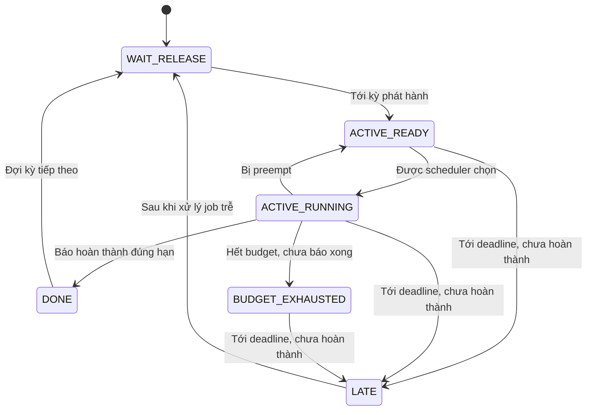
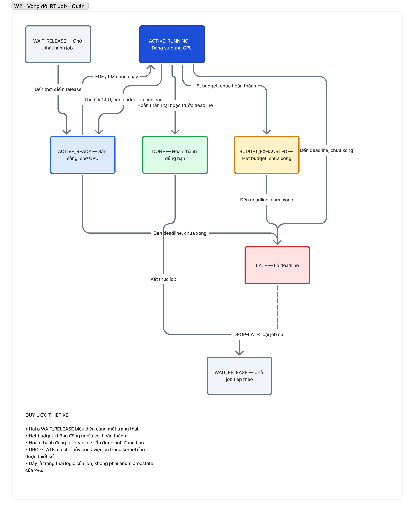

# Thiết kế metadata và vòng đời job thời gian thực

- Người thực hiện: Trịnh Minh Quân – 20233599
- Task: OPRTS-43
- Phạm vi: thiết kế, chưa thay đổi mã nguồn kernel.
- Trạng thái: đề xuất để nhóm review trước khi hiện thực.

## 1. Mục tiêu và giả định

Thiết kế thông tin giúp kernel quản lý task tuần hoàn và lựa chọn
job theo EDF hoặc RM.

Các giả định của mô hình:

- Một CPU cho phiên bản RT đầu tiên.
- Task tuần hoàn.
- Deadline tương đối bằng period: D = T.
- Có preemption.
- Thời gian được biểu diễn bằng tick.
- Simulator giả sử overhead bằng 0; kernel thực tế vẫn có overhead.

Task mô tả công việc lặp lại. Mỗi lần phát hành công việc là một job.

Ví dụ: task A có period 5 tick thì các job A1, A2, A3 được phát hành
cách nhau 5 tick.

## 2. Metadata đề xuất

Đoạn dưới là cấu trúc dự kiến, chưa được thêm vào kernel.

```c
struct rt_meta {
  int enabled;            // Process đã đăng ký chế độ thời gian thực hay chưa

  uint64 period;          // Khoảng thời gian giữa hai lần phát hành job
  uint64 budget;          // Số tick CPU tối đa dành cho mỗi job

  uint64 release_time;    // Thời điểm phát hành job hiện tại
  uint64 abs_deadline;    // Deadline tuyệt đối của job hiện tại
  uint64 next_release;    // Thời điểm phát hành job tiếp theo
  uint64 consumed;        // Số tick CPU job hiện tại đã sử dụng

  int job_active;         // Có job hiện tại đang được quản lý
  int miss_recorded;      // Đã ghi nhận deadline miss cho job hiện tại

  uint64 job_id;          // Số thứ tự job
  uint64 completed_jobs; // Tổng số job hoàn thành đúng hạn
  uint64 deadline_misses; // Tổng số job trễ deadline
};
```

**Ý nghĩa:** `rt_meta` bổ sung các thông tin mà `struct proc` gốc
chưa có, phục vụ phát hành job, tính budget, chọn ưu tiên và thống kê.

Dự kiến đặt một trường trong `struct proc`:

```c
struct rt_meta rt; // Metadata thời gian thực của process
```

Kiểu dữ liệu và cách đọc thời gian phải được đối chiếu với bộ đếm
ticks của xv6 khi hiện thực. Dùng uint64 cho metadata không tự
giải quyết việc bộ đếm nguồn bị tràn.

## 3. Ý nghĩa và quy tắc của từng trường

| Trường | Quy tắc |
|---|---|
| `enabled` | Bằng 0 đối với process thông thường |
| `period` | Phải lớn hơn 0 |
| `budget` | Phải lớn hơn 0 và không vượt period trong mô hình D = T |
| `release_time` | Mốc phát hành job hiện tại |
| `abs_deadline` | Bằng release_time + period |
| `next_release` | Bằng release_time + period khi D = T |
| `consumed` | Đặt lại bằng 0 khi phát hành job mới |
| `job_active` | Không tự chứng minh process có thể chạy; còn phải xét state và budget |
| `miss_recorded` | Ngăn đếm nhiều lần cùng một job trễ |
| `job_id` | Tăng khi phát hành job mới |
| `completed_jobs` | Tăng khi xác nhận job hoàn thành đúng hạn |
| `deadline_misses` | Tăng đúng một lần cho mỗi job trễ |

Các điều kiện period và budget chỉ kiểm tra tính hợp lệ của tham số.
Chúng chưa đủ để chấp nhận cả tập task; admission còn phụ thuộc EDF/RM.

## 4. Phân biệt trạng thái process và trạng thái job

Trạng thái process có sẵn trong xv6:

```c
RUNNABLE // Process đủ điều kiện được scheduler xem xét
RUNNING  // Process đang chạy
SLEEPING // Process đang chờ một sự kiện
```

Trạng thái job mô tả tiến độ của một lần thực hiện công việc:

| Trạng thái job | Ý nghĩa |
|---|---|
| `WAIT_RELEASE` | Đang đợi kỳ phát hành tiếp theo |
| `ACTIVE_READY` | Job đã được phát hành và sẵn sàng chạy |
| `ACTIVE_RUNNING` | Job đang sử dụng CPU |
| `DONE` | Job đã báo hoàn thành |
| `BUDGET_EXHAUSTED` | Job hết budget nhưng chưa được xác nhận hoàn thành |
| `LATE` | Job chưa hoàn thành khi tới deadline |

**Ý nghĩa:** hai loại trạng thái không thay thế nhau.

Ví dụ, một process có trạng thái RUNNABLE vẫn chưa chắc được chọn
chạy như một RT job nếu job chưa được phát hành hoặc đã hết budget.

Các trạng thái job trong tài liệu là mô hình logic. Nhóm sẽ quyết định
có lưu bằng enum riêng hay suy ra từ metadata khi hiện thực.

## 5. Phát hành job mới

Mã giả dưới đây mô tả cập nhật metadata khi tới mốc phát hành.

Điều kiện trước: job cũ đã được xử lý hoàn thành hoặc xử lý trễ,
không còn được tiếp tục thực thi như job cũ.

```c
rt.release_time = scheduled_release; // Dùng mốc phát hành theo lịch
rt.abs_deadline = rt.release_time + rt.period; // Tính deadline của job
rt.next_release = rt.release_time + rt.period; // Tính kỳ tiếp theo

rt.consumed = 0;        // Bắt đầu tính CPU cho job mới
rt.job_active = 1;      // Kích hoạt job mới
rt.miss_recorded = 0;   // Cho phép ghi nhận miss của job mới
rt.job_id++;           // Tăng số thứ tự job
```

**Ý nghĩa:** mỗi job có deadline và bộ đếm CPU riêng. Lịch phát hành
dựa trên mốc định kỳ, không dựa trên thời điểm job trước hoàn thành.

Khi kernel xử lý muộn hoặc bỏ lỡ nhiều kỳ, phải xác định rõ chính sách
bỏ qua hoặc ghi nhận các kỳ đã lỡ. Không tự đổi lịch thành now + period.

## 6. Điều kiện được chọn chạy

Mã giả:

```c
eligible =
    rt.enabled &&                // Là process thời gian thực
    p->state == RUNNABLE &&       // Process đang sẵn sàng chạy
    rt.job_active &&             // Có job đang hoạt động
    now >= rt.release_time &&    // Job đã tới thời điểm phát hành
    now < rt.abs_deadline &&     // Job chưa tới deadline
    rt.consumed < rt.budget;     // Job vẫn còn budget
```

**Ý nghĩa:** scheduler chỉ so sánh ưu tiên giữa các ứng viên hợp lệ.

- EDF: ưu tiên deadline tuyệt đối nhỏ hơn.
- RM: ưu tiên period nhỏ hơn.
- Tie-break phải thống nhất với đặc tả và simulator của nhóm.

Process thông thường cần chính sách chạy riêng, dự kiến chạy khi
không có RT job đủ điều kiện. Chi tiết phải được nhóm review.

## 7. Tính lượng CPU đã sử dụng

Mã giả cho một đơn vị tick được quy thuộc cho job đang chạy:

```c
rt.consumed++; // Tăng khi job thực sự được tính là đã sử dụng CPU
```

**Ý nghĩa:** consumed đo thời gian CPU, không phải thời gian kể từ
release. Job chờ CPU hoặc bị preempt không được tăng consumed.

Ví dụ: job được phát hành tại t = 0, đợi tới t = 3 rồi chạy một tick
thì consumed bằng 1, không phải 4.

Khi hiện thực, phải chốt cách quy thuộc timer tick cho process đang
chạy và tránh tính trùng. Độ chính xác bị giới hạn bởi độ phân giải tick.

## 8. Preemption

```c
// Mô tả logic khi một job bị ngắt để nhường CPU
p->state = RUNNABLE; // Process trở lại trạng thái sẵn sàng

// Giữ nguyên release_time, abs_deadline, consumed và job_id
```

**Ý nghĩa:** preemption chỉ tạm dừng job hiện tại, không tạo job mới
và không đặt lại budget. Khi được chọn lại, job tiếp tục phần việc còn lại.

Việc thay đổi trạng thái và chuyển context phải tuân thủ p->lock
và các điều kiện của sched() trong xv6.

## 9. Hoàn thành job

Dự kiến chương trình người dùng gọi rt_job_done() để báo hoàn thành.

Mã giả cho trường hợp job được xác nhận hoàn thành đúng hạn:

```c
rt.completed_jobs++; // Ghi nhận một job hoàn thành đúng hạn
rt.job_active = 0;   // Job hiện tại không còn cần CPU

// Cho process đợi tới next_release bằng cơ chế sleep/wakeup phù hợp
```

**Ý nghĩa:** kernel cần tín hiệu hoàn thành rõ ràng từ chương trình.
Không thể chỉ nhìn consumed để biết thuật toán của chương trình đã xong.

Lời gọi hoàn thành phải được kiểm tra tính hợp lệ, tránh tăng bộ đếm
nhiều lần cho cùng một job.

Theo mô hình, hoàn thành đúng tại deadline được tính là đúng hạn.
Cách xác định thời điểm hoàn thành trong kernel cần thống nhất với
thứ tự cập nhật tick và xử lý syscall.

## 10. Hết budget

```c
if (rt.consumed >= rt.budget) { // Job đã dùng hết ngân sách CPU
  // Không tiếp tục chọn job này để chạy
  // Không tự tăng completed_jobs
}
```

**Ý nghĩa:** hết budget nghĩa là job đã dùng hết lượng CPU được cấp,
không có nghĩa công việc đã hoàn thành.

Nếu chưa có xác nhận hoàn thành, job vẫn cần được theo dõi tới deadline.
Khi đó có thể phát sinh deadline miss.

Điểm cần chốt trước khi hiện thực: chương trình báo rt_job_done()
thế nào khi vừa dùng hết budget, và chi phí syscall được tính ra sao.
Phải tránh thiết kế khiến job hoàn thành nhưng không thể báo hoàn thành.

## 11. Deadline miss và DROP-LATE

Mã giả phát hiện miss sau khi đã xử lý các hoàn thành tại cùng mốc thời gian:

```c
if (rt.job_active &&
    now >= rt.abs_deadline &&
    !rt.miss_recorded) {
  rt.deadline_misses++; // Tăng bộ đếm đúng một lần cho job này
  rt.miss_recorded = 1; // Ngăn các lần kiểm tra sau đếm lại
}
```

**Ý nghĩa:** job chưa hoàn thành khi tới deadline được ghi nhận là trễ.

Chính sách DROP-LATE trong simulator:

- Ghi nhận miss.
- Bỏ phần thực thi còn lại của job trễ.
- Xử lý phát hành job tiếp theo theo lịch.

Giới hạn khi chuyển sang kernel:

- Xóa metadata không làm chương trình tự quay về đầu công việc.
- Process có thể đang ở giữa vòng lặp hoặc giữ tài nguyên.
- Không được coi phần code còn lại của job cũ là job mới.

Vì vậy, DROP-LATE trong kernel chưa được coi là thiết kế hoàn chỉnh.
Nhóm cần chốt cơ chế phối hợp với chương trình người dùng hoặc
cơ chế dừng/hủy phù hợp trước khi hiện thực.

## 12. Thứ tự xử lý tại biên tick

Trong mô hình tick rời rạc, đề xuất thứ tự:

1. Ghi nhận kết quả của khoảng chạy vừa kết thúc.
2. Xử lý hoàn thành tại thời điểm hiện tại.
3. Kiểm tra deadline miss của các job chưa hoàn thành.
4. Xử lý job trễ theo chính sách đã chốt.
5. Phát hành các job tới kỳ.
6. Chọn job để chạy trong khoảng tiếp theo.

**Ý nghĩa:** job hoàn thành đúng deadline không bị ghi nhầm là miss,
và job cũ được xử lý trước khi metadata bị thay bằng job mới.

Kernel không thực hiện các bước bằng một vòng lặp mô phỏng duy nhất.
Cần phối hợp timer, syscall và scheduler để đạt hành vi tương ứng.

## 13. Sơ đồ vòng đời job



Mũi tên từ LATE về WAIT_RELEASE mô tả chính sách mong muốn.
Cơ chế thực hiện an toàn trong kernel còn cần được nhóm thống nhất.

## 14. Vị trí dự kiến tích hợp vào xv6

| Vị trí | Trách nhiệm dự kiến |
|---|---|
| `kernel/proc.h` | Khai báo metadata RT trong struct proc |
| `allocproc()` trong `kernel/proc.c` | Khởi tạo metadata về trạng thái chưa đăng ký |
| `freeproc()` trong `kernel/proc.c` | Xóa metadata khi thu hồi process |
| `scheduler()` trong `kernel/proc.c` | Chọn process theo EDF/RM |
| Đường xử lý timer | Tính CPU sử dụng và kích hoạt xử lý mốc thời gian |
| `kernel/sysproc.c` | Xử lý đăng ký RT và báo hoàn thành |
| Các file khai báo, dispatch syscall | Kết nối API người dùng với kernel |

Chưa chốt cách giữ lock giữa tickslock và p->lock.
Không duyệt process hoặc gọi cơ chế đánh thức tùy tiện trong lúc
giữ tickslock; cần kiểm tra thứ tự lock để tránh deadlock.

## sơ đồ vòng đời RT job

Link FigJam: https://www.figma.com/board/cnW4szKxKBeDlrX66pZ5iI/Project-13-%E2%80%93-xv6-architecture-%E2%80%93-W01?node-id=0-1&t=L8BzdxWcaxE045KD-1

