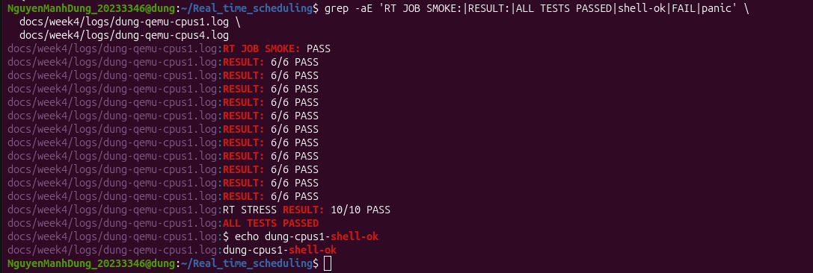

# Kết quả kiểm tra phần Dũng — Tuần 4

## Phạm vi

Kiểm tra bản tích hợp phần nền của Quân (metadata, bộ chọn EDF)
với vòng đời job RT của Dũng. Chưa tích hợp trace của Thành.

Thay đổi của Dũng:
- Thêm kernel/rt.c: release job, đồng hồ RT, trừ budget,
  completion, phát hiện deadline miss và chờ trước khi về user.
- Thay sys_sched_setdeadline: trả 0 khi nhận, -1 khi tham số sai,
  -2 khi quá tải, -3 khi đổi cấu hình đang active.
- Thêm syscall rt_job_done (số 24) vào syscall.h, syscall.c,
  sysproc.c, user.h và usys.pl.
- Nối hook trong kernel/trap.c: rt_kernel_enter, rt_current_active,
  rt_prepare_user_return và rt_clock_tick (chỉ CPU 0).
- Thêm user/rt_job_smoke.c và khai báo trong kernel/defs.h, Makefile.
- Commit make fmt chỉ đổi định dạng, không đổi logic.

Chính sách deadline miss: carry-over. Job chưa xong khi hết kỳ được
cấp lại budget nhưng giữ job ID và deadline cũ, đếm miss một lần
cho mỗi job. Khác DROP-LATE của simulator.

## Kết quả

| Kiểm tra | CPUS=1 | CPUS=4 |
|---|---|---|
| rt_job_smoke | PASS | PASS |
| rttest | 6/6 PASS | 6/6 PASS |
| rtstress | 10/10 PASS | 10/10 PASS |
| usertests | ALL TESTS PASSED | ALL TESTS PASSED |
| ls và echo sau suite | Hoạt động | Hoạt động |

Build kernel và fs.img: BUILD_EXIT_CODE=0 (kiểm tra lại trong
logs/dung-build.log trước khi nộp).

Ghi chú: một lần chạy CPUS=4 trước đó gặp "exec echo failed" do
fs.img cũ. Đã tạo lại fs.img và chạy lại; log trong thư mục này
là của lần chạy lại.

## Minh chứng

- logs/dung-build.log
- logs/dung-version.txt
- logs/dung-changes.txt
- logs/dung-qemu-cpus1.log
- logs/dung-qemu-cpus4.log
- logs/dung-grep-cpus1.png

Kết quả lọc log CPUS=1 bằng grep:

## Giới hạn

Các kết quả trên kiểm tra khả năng build, chạy và tương thích.
Chưa chứng minh release đúng mốc chu kỳ, budget giảm đúng khi chạy
và không giảm khi ngủ, gọi lại cùng T và C không reset budget,
miss đếm đúng một lần mỗi job, rò trang và inode, grind, và stress
lặp ít nhất 10 lượt trên CPUS=4. Các mục này chờ trace và test
của Thành.

Tick vẫn là baseline (khoảng 0,1 giây). Budget không phải giới hạn
CPU cứng vì đường kernel đang chạy được hoàn tất trước khi chặn
trở về user.
